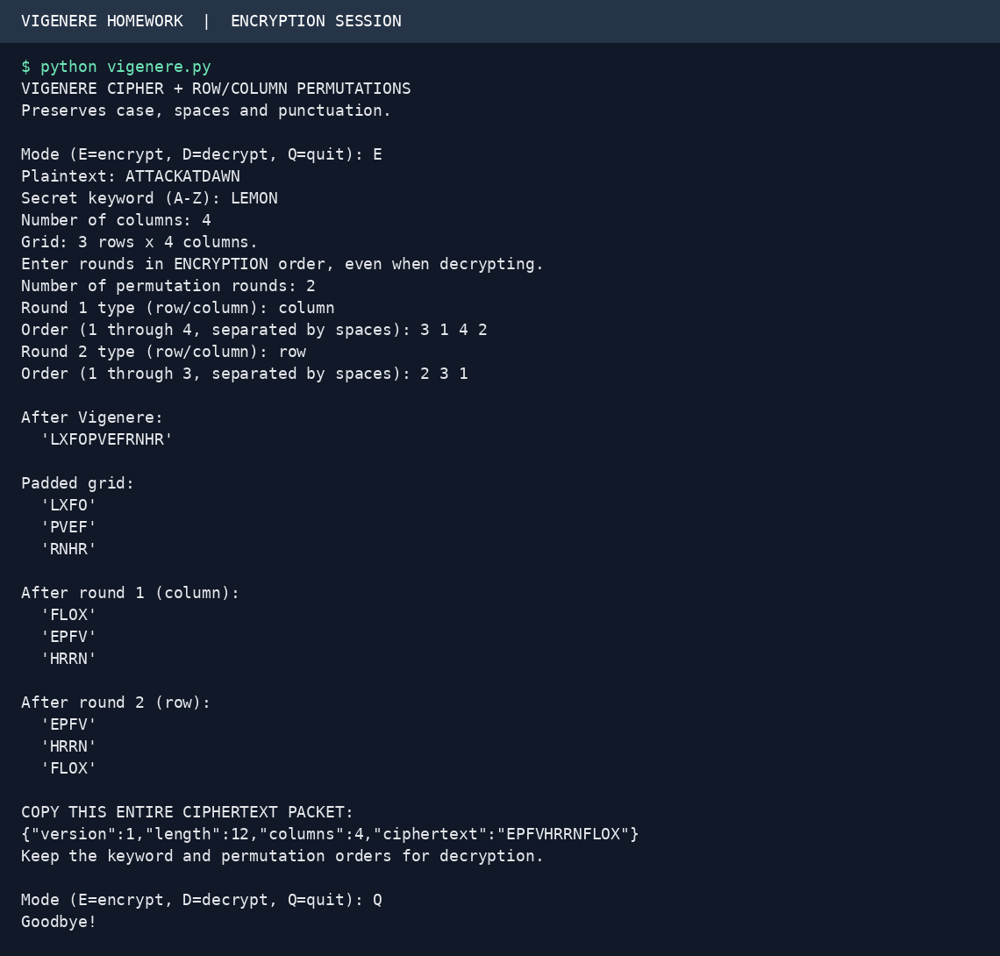
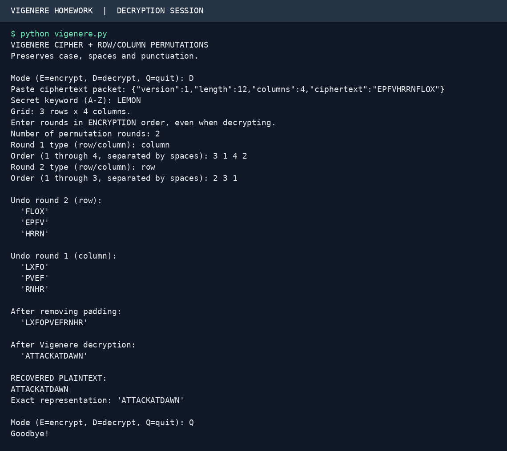
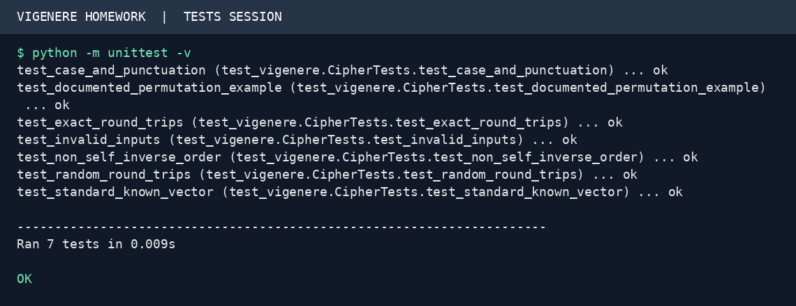

# Vigenere Cipher with Multi-Round Permutations

This Python project encrypts text with the Vigenere cipher, then applies a
user-selected sequence of row and column permutations. Decryption restores the
exact original message using the same keyword and permutation parameters.

## 1. Files and requirements

- `vigenere.py`: documented implementation and interactive terminal interface.
- `test_vigenere.py`: known-answer, round-trip, and input-validation tests.
- `assets/encryption.png`: image of a recorded encryption session.
- `assets/decryption.png`: image of a recorded decryption session.
- `assets/tests.png`: image of the test run.
- `assets/*.txt`: the corresponding captured terminal transcripts.

Install Python 3. No third-party packages or compilation are needed to run the
program or tests. The PNG images are terminal-style renderings of actual captured
program sessions, not screenshots of a desktop application.

## 2. Run the program

Open a terminal in this project folder:

```bash
python vigenere.py
```

If your computer uses `python3`, substitute `python3` for `python` in the commands.
Choose `E` to encrypt, `D` to decrypt, or `Q` to quit.

## 3. Step one: Vigenere substitution

Assign the values A=0, B=1, ..., Z=25. Repeat the keyword over the English letters
of the message. For each letter:

```text
Encryption: C = (P + K) mod 26
Decryption: P = (C - K) mod 26
```

`P` is the plaintext letter's value; `K` is the key letter's value; `C` is the
ciphertext letter's value. Modulo 26 wraps around the alphabet.

For plaintext `ATTACKATDAWN` and keyword `LEMON`:

| Position | 1 | 2 | 3 | 4 | 5 | 6 | 7 | 8 | 9 | 10 | 11 | 12 |
|---|---|---|---|---|---|---|---|---|---|---|---|---|
| Plaintext | A | T | T | A | C | K | A | T | D | A | W | N |
| Repeated key | L | E | M | O | N | L | E | M | O | N | L | E |
| Ciphertext | L | X | F | O | P | V | E | F | R | N | H | R |

The first calculation is `(0 + 11) % 26 = 11`, giving `L`. The second is
`(19 + 4) % 26 = 23`, giving `X`.

The implementation preserves capitalization. Spaces, digits, punctuation and
non-English characters are unchanged by substitution and do not advance the
keyword. They still participate in the later permutations.

## 4. Step two: build a rectangular grid

The user chooses the number of columns. The program calculates the number of
rows as `max(1, ceil(message_length / columns))` and fills the grid row by row.
If necessary, spaces pad the final row. An empty message uses one padded row.

With 4 columns, `LXFOPVEFRNHR` becomes:

| Row | Column 1 | Column 2 | Column 3 | Column 4 |
|---|---|---|---|---|
| 1 | L | X | F | O |
| 2 | P | V | E | F |
| 3 | R | N | H | R |

## 5. Step three: permute columns

A key lists **which old positions to take, in the new order**. Positions start
at 1. The column key `3 1 4 2` means take old column 3, then 1, then 4, then 2.
Apply that same order to every row:

| Row | New column 1 | New column 2 | New column 3 | New column 4 |
|---|---|---|---|---|
| 1 | F | L | O | X |
| 2 | E | P | F | V |
| 3 | H | R | R | N |

Flattened intermediate result: `FLOXEPFVHRRN`.

## 6. Step four: permute rows

Use row key `2 3 1`: take old row 2, then row 3, then row 1.

| Row | Column 1 | Column 2 | Column 3 | Column 4 |
|---|---|---|---|---|
| 1 | E | P | F | V |
| 2 | H | R | R | N |
| 3 | F | L | O | X |

Read across the rows to obtain final ciphertext **`EPFVHRRNFLOX`**.

The program supports any positive number of permutation rounds, including
repeated row or column rounds. Each order must contain every relevant position
exactly once. `1 1 3` is invalid because it duplicates one position and loses
another.

## 7. Step five: copy the ciphertext packet

The example's complete output is:

```json
{"version":1,"length":12,"columns":4,"ciphertext":"EPFVHRRNFLOX"}
```

The packet stores the format version, original character count, grid width, and
ciphertext. It does **not** store the secret keyword or permutation orders.
Keep those parameters separately. Copy the entire JSON line, including braces.

Why store the length? A message may genuinely end with spaces. Decryption must
remove only added padding, so it slices at the saved length instead of using
`strip()` or `rstrip()`. JSON safely encodes special characters in a single line.
Lengths count Python string characters, not UTF-8 bytes.

## 8. Step six: reverse the process

During decryption, enter the same rounds in their original **encryption order**.
The program reverses them automatically:

1. Rebuild the ciphertext grid from the packet.
2. Undo row round 2 with inverse order `3 1 2`.
3. Undo column round 1 with inverse order `2 4 1 3`.
4. Flatten the restored grid and slice at the original length to remove padding.
5. Apply Vigenere subtraction to recover `ATTACKATDAWN`.

If encryption takes old position `order[i]` into new position `i`, the inverse
puts it back. In 1-based notation:

```text
inverse[order[i]] = i
```

For example, row order `2 3 1` places old row 1 at new position 3, old row 2 at
new position 1, and old row 3 at new position 2. To recover the old order, take
new rows `3 1 2`.

## 9. Try the complete example

Enter these responses to encrypt:

| Prompt | Response |
|---|---|
| Mode | `E` |
| Plaintext | `ATTACKATDAWN` |
| Secret keyword | `LEMON` |
| Number of columns | `4` |
| Number of permutation rounds | `2` |
| Round 1 type | `column` |
| Round 1 order | `3 1 4 2` |
| Round 2 type | `row` |
| Round 2 order | `2 3 1` |

Then select `D`, paste the complete packet, enter `LEMON`, and enter the same
two rounds in the same order. The grid dimensions come from the packet, so
decryption does not ask for the column count again. Expected recovered text:
`ATTACKATDAWN`.





## 10. Test cases

Run the tests from the project directory:

```bash
python -m unittest -v
```

| Case | Inputs / parameters | Expected behavior |
|---|---|---|
| Standard Vigenere | `ATTACKATDAWN`, key `LEMON` | `LXFOPVEFRNHR` before permutations |
| Full worked example | 4 columns; column `3 1 4 2`; row `2 3 1` | Final `EPFVHRRNFLOX`; exact recovery |
| Mixed case and punctuation | `Attack at dawn!`, key `LEMON` | Substitution `Lxfopv ef rnhr!` |
| Padding and real spaces | `  Hello, World!  `, key `Key`, 4 columns | All spaces and punctuation restored |
| Empty input | Empty message, key `Key`, 4 columns | Empty string restored |
| Special characters | Newlines, tabs, accented/Arabic characters, emoji | Exact recovery through the Python functions |
| Multiple rounds | 100 seeded messages, four rounds each | Every decrypted value equals its original |
| Invalid input | Duplicate positions, invalid keyword, malformed packet | Clear validation errors |

The terminal interface reads a single-line plaintext. The Python `encrypt` and
`decrypt` functions also support multiline strings. Tests cover both.



## 11. Understand the implementation

| Function | Purpose |
|---|---|
| `vigenere` | Letter substitution in either direction |
| `validate_order` | Reject missing, duplicate or out-of-range positions |
| `inverse_order` | Calculate an inverse permutation |
| `permute` | Apply a row or column order, optionally inverted |
| `encrypt` | Substitute, pad, apply rounds, produce the JSON packet |
| `parse_packet` | Validate the pasted JSON and its dimensions |
| `decrypt` | Reverse rounds, remove padding, reverse substitution |
| `main` | Present the menu and handle interactive input |

For `N` padded characters and `R` rounds, transformations take `O(R*N)` time
and `O(N)` working memory, aside from storing the supplied permutation keys.
Order validation additionally sorts each order (`O(k log k)` per validation).

This is a classical-cipher teaching project. It provides no authentication:
a wrong keyword or a different valid permutation can produce incorrect text
without an error. Exact recovery requires the same keys and an unchanged packet.
Applying the same row order across all columns and the same column order across
all rows is reversible, but these rounds can be combined into equivalent
permutations; adding rounds does not make this modern secure encryption.

## 12. Submission checklist

1. Run the program and read the worked example so you can explain the logic.
2. Create your GitHub repository and upload this folder's contents, including
   `README.md`, the Python files, and the complete `assets` directory.
3. Check that the images display in the repository README and that the code runs.
4. Follow your instructor's repository visibility and collaboration requirements.
5. Submit your actual GitHub repository URL through Blackboard.

The downloadable package contains the local project. Creating the GitHub
repository and submitting its URL are separate steps.
